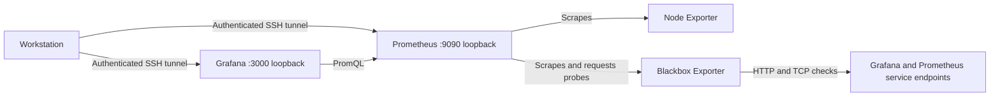

# IT Operations & Automation Lab

[](https://github.com/RyanBarnes321/it-operations-lab/actions/workflows/quality.yml)

A self-hosted Debian operations environment featuring Docker-based monitoring,
HTTP/TCP availability checks, alerting, cross-platform diagnostics, incident
investigation, and encrypted backup recovery.

Built on a Dell i5-7200U with 15 GiB RAM and SSD storage, this project demonstrates
how to operate services: detect failures, investigate their causes, make controlled
repairs, and verify recovery. It complements backend development with Linux,
networking, observability, Bash, PowerShell, and operational documentation.

**v1.0.1:** bounded CI readiness checks and documented recovery evidence.
[Linux and Windows CI](https://github.com/RyanBarnes321/it-operations-lab/actions/workflows/quality.yml)
validate the source and disposable test environments. See the
[release notes](docs/releases/v1.0.1.md), [release checklist](docs/RELEASE-CHECKLIST.md)
and [publication provenance](docs/PUBLICATION.md) for scope, verification and limitations.

## Demonstrations to explore

| Demonstration | What to review |
|---|---|
| Real monitoring | [Six-panel dashboard, seven expressions, seven targets and four probes](docs/MONITORING.md) |
| Alert firing and recovery | [Controlled exporter failure](docs/incidents/005-exporter-stopped.md) and [deterministic tests for three rules](tests/alerts.yml) |
| A real provisioning failure | [Grafana permission diagnosis and repair](docs/incidents/001-grafana-permissions.md) |
| Automated troubleshooting | [Bash and PowerShell diagnostics](docs/AUTOMATION.md): twelve Bash cases and nine user-executed Windows cases |
| Encrypted recovery | [Off-device backup workflow](docs/runbooks/off-device-backup.md), USB identity recovery and isolated Grafana/Prometheus restoration |
| Operational judgment | [Runbooks](docs/runbooks/operations.md), [failure scenarios](docs/incidents/) and [evidence with provenance](docs/TEST-EVIDENCE.md) |

Final live observations: **7/7 targets UP, 4/4 probes successful, zero active alerts,
Grafana database healthy, four services running**. The user's Nov 12 checks and
Codex's independent final checks are recorded separately in the evidence index.
These are point-in-time observations, not an uptime guarantee.

## Architecture



| Service | Version | Role |
|---|---|---|
| Grafana | 13.3.1 | Authenticated, provisioned dashboard |
| Prometheus | 2.55.1 | 15-second scraping/evaluation, 15-day retention |
| Node Exporter | 1.8.2 | Host CPU, memory, filesystem and uptime metrics |
| Blackbox Exporter | 0.27.0 | HTTP/TCP probes inside the Compose network |

Only Grafana and Prometheus publish host ports, both on `127.0.0.1`; exporters
remain on the Docker network. Services have a combined 2 GiB memory ceiling;
Linux and Docker need additional RAM. Network counters reflect the exporter's
bridge namespace, not independently verified host-NIC traffic. Alerts remain local.
See [architecture and trust boundaries](docs/architecture/overview.md).

## Deploy and validate

Requirements: Linux, Docker Engine with Compose v2, Bash/coreutils, curl, getent,
OpenSSL, trusted SSH access and space for images, metrics and backup copies.
Python 3.12+ is needed for restore drills; PowerShell 7 on Windows for Windows tests.
The [installation runbook](docs/runbooks/installation.md) covers ownership, fresh
secret generation, provisioning permissions, ports and manual acceptance steps.
A separate clean-host deployment has not been rehearsed.

After completing that runbook's fresh-secret setup:

```sh
docker compose config -q
docker compose up -d
./scripts/validate.sh
```

From an authorized workstation, use your own SSH account and host:

```sh
ssh -N -o ExitOnForwardFailure=yes -L 3000:127.0.0.1:3000 -L 9090:127.0.0.1:9090 '<lab-user>@<lab-address>'
```

Open `http://localhost:3000/d/dell-lab-overview` with the new Grafana admin password;
Prometheus is at `http://localhost:9090`. Wait five minutes for rate samples.
[Monitoring](docs/MONITORING.md) explains panels, probes and alerts;
[operations](docs/runbooks/operations.md) covers validation, incidents and recovery.
[Quality checks](docs/QUALITY.md) documents local checks and independent CI runners.

## Evidence and limits

Historical evidence includes alert firing/recovery, twelve Bash checks, nine
user-executed Windows tests, encrypted off-device recovery and USB key recovery.
[The evidence index](docs/TEST-EVIDENCE.md) separates historical records, user reports
and final Codex checks. The user's dashboard screenshot and original Windows runner
JSON are unavailable in this checkout; no screenshot has been fabricated.

This single-host lab has a defective battery, manual LUKS unlocking after power
loss, no automatic power restoration, manual backups, no guaranteed RPO/RTO, and
no independently verified geographically separate offsite backup. Centralized
logging and external alert delivery are deferred. Local root and Docker admins
are trusted. Read [limitations](docs/LIMITATIONS.md), [security review](docs/SECURITY.md),
[progress](docs/PROGRESS.md), and [planned work](docs/ROADMAP.md).

Licensed under [MIT](LICENSE).
