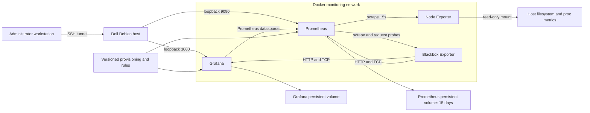

# Architecture

Only Grafana and Prometheus have host ports, both loopback. Other containers
are reachable on the Compose bridge. This is private exposure, not isolation from
other local users or Docker administrators. Node Exporter uses host PID namespace
and read-only root access for host metrics; Docker membership is privileged.
No remote logging flow is deployed. Docker logs are local operational evidence.
Grafana's authentication and existing secret files are preserved. Memory limits:
Grafana 1 GiB, Prometheus 768 MiB, exporters 128 MiB each. Prometheus retention is
15 days; volume capacity must still be monitored. Images retain existing versions.
Blackbox configuration follows the upstream multi-target pattern:
https://prometheus.io/docs/guides/multi-target-exporter/ .

Release-candidate restore verification uses a separate temporary **internal** Docker
network containing restored Grafana and Prometheus only. No ports are published;
no live volumes are mounted, and production services are not connected. The host
validation harness queries the temporary bridge address, then removes the drill.
This network exists only during a drill, not as a deployed monitoring component.

Proposed backup flow: consistent local state archive → age public-key encryption
on Dell → user-initiated SCP pull to Windows over existing private SSH → protected
Windows directory. Only ciphertext leaves the Dell. The Windows identity and its
independent recovery copy remain controlled by the user. This transfer is proposed,
not yet observed; same-house off-device storage is not offsite protection.
