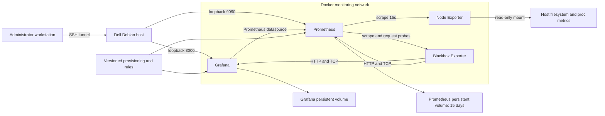
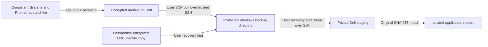

# Architecture

Only Grafana and Prometheus have host ports, both loopback. Other containers
are reachable on the Compose bridge. This is private exposure, not isolation from
other local users or Docker administrators. Node Exporter uses host PID namespace
and read-only root access for host metrics; Docker membership is privileged.
No remote logging flow is deployed. Docker logs are local operational evidence.
Grafana's authentication and existing secret files are preserved. Memory limits:
Grafana 1 GiB, Prometheus 768 MiB, exporters 128 MiB each. Prometheus retention is
15 days; volume capacity must still be monitored. Images retain existing versions.
Blackbox configuration follows the upstream multi-target pattern:
https://prometheus.io/docs/guides/multi-target-exporter/ .

Isolated restore verification uses a separate temporary **internal** Docker
network containing restored Grafana and Prometheus only. No ports are published;
no live volumes are mounted, and production services are not connected. The host
validation harness queries the temporary bridge address, then removes the drill.
This network exists only during a drill, not as a deployed monitoring component.

## Verified backup workflow

The user reports a successful Windows round trip, matching original archive and
USB identity recovery test. The returned restore record verifies seven historical
queries and unchanged production state. This final session reviewed the evidence;
it did not perform the Windows transfer or inspect the recovery identity. Only
ciphertext is exported for backup storage; decrypted test material is returned
through trusted SSH to private staging for recovery verification. Same-house
Windows storage is off-device, not independently verified offsite protection.
See [backup procedure](../runbooks/off-device-backup.md) and
[evidence attribution](../TEST-EVIDENCE.md).

## Dependencies and namespace scope

Grafana queries `http://prometheus:9090`; Prometheus scrapes service DNS names
(`node-exporter:9100`, `blackbox:9115`, and `prometheus:9090`). Blackbox probes
Grafana port 3000 and Prometheus port 9090 using HTTP and TCP. Compose supplies DNS;
no fixed host/LAN address is required. There is no startup-order guarantee or
`depends_on` health gating: scrapes and probes retry, and installation acceptance
waits for readiness and rate samples. Grafana provisioning refers to a stable
Prometheus datasource UID, not a host IP.

Node Exporter uses host PID/root filesystem access with bridge networking. Network
counters reflect its network namespace, not verified physical host NIC counters.
The four memory limits total 2 GiB; 15-day metric retention is appropriate for
a small lab but is not a byte quota. Backups, TSDB growth and Docker logs require
manual disk-capacity monitoring. There is no configured CPU quota.
